# NexusFramework UML 模型

> 本文档基于代码实况生成，覆盖 `NexusFramework`（框架层）、`NexusFramework.GAS`（技能系统层）与二者共享的 Unity ECS 承载层。
> 图表使用 Mermaid，可在支持 Mermaid 的 Markdown 渲染器（VS Code、GitHub、Typora）中直接查看。

---

## 1. 总览：模块分层

自下而上四层，每层只依赖其下层：

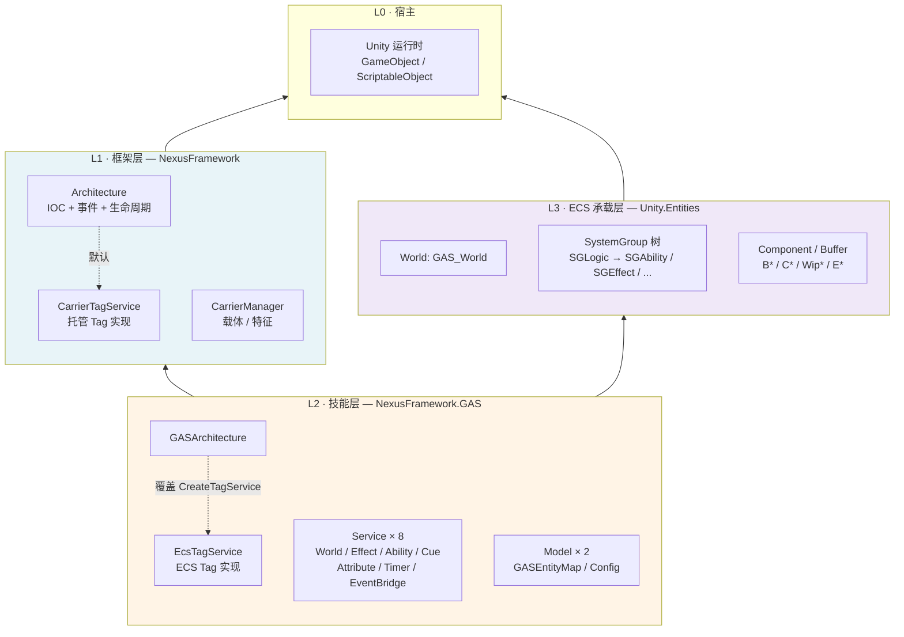

**关键设计决策**：
- 框架层不依赖 ECS。`ITagService` 是抽象契约，`Architecture.CreateTagService()` 是虚方法——GAS 模块覆盖它把 Tag 的真相源从托管字典换成 ECS。
- 两套 Tag 实现共存：非 GAS 场景用 `CarrierTagService`（纯托管字典），GAS 场景用 `EcsTagService`（ECS 为真相源）。

---

## 2. 框架层类图

### 2.1 架构内核

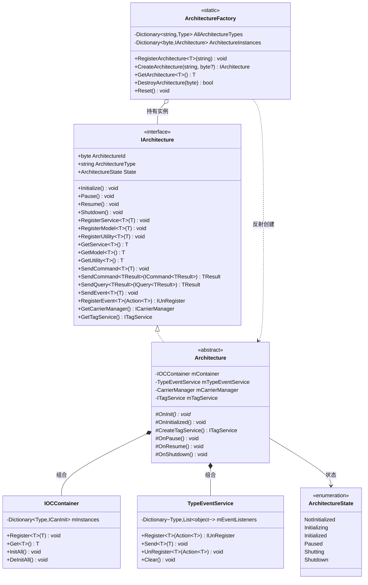

### 2.2 生命周期钩子与事件

`Initialize()` 的严格次序——注释中明确指出 `OnInitialized()` 必须在 `ArchitectureAfterInitEvent` **之前**调用，否则订阅者会读到不完整状态（如 GAS 的 Tag 层级尚未烘焙）。

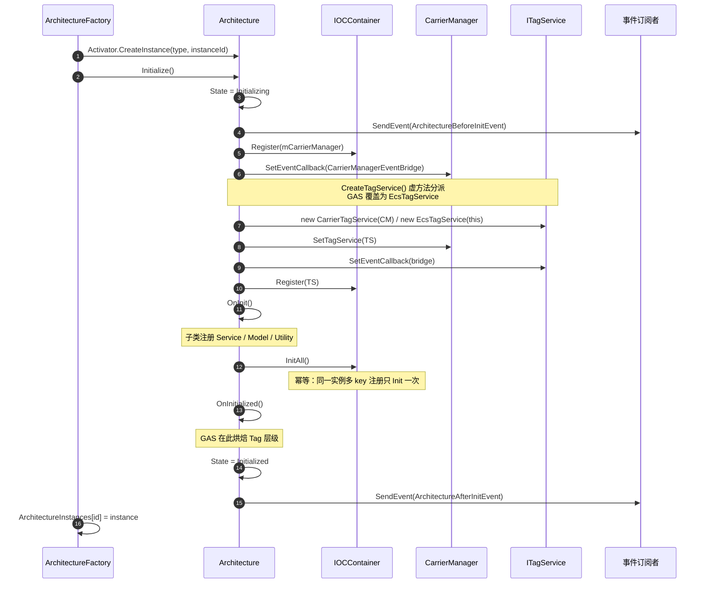

### 2.3 规则接口（能力组合）

框架用「小接口 + 扩展方法」实现能力隔离：`IController` 拿到全部能力，`IQuery` 只能只读访问载体。

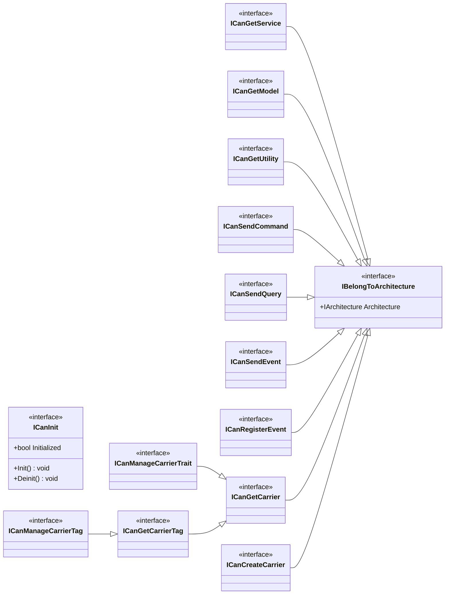

**角色 → 能力对照表**（代码中的实际组合）：

| 角色 | 能力构成 | 载体访问权限 |
|---|---|---|
| `IController` | Command + Service + Model + Event + Query + Utility | **完整**：读 / 建 / 改 Trait + Tag 读写 |
| `IService` | Model + Utility + Event + `ICanInit` | **完整**：读 / 建 / 改 Trait + Tag 读写 |
| `ICommand` / `ICommand<T>` | Service + Model + Utility + Event + Command + Query | **完整**：读 / 建 / 改 Trait + Tag 读写 |
| `IModel` | Utility + Event + `ICanInit` | **仅 Tag 只读**（`ICanGetCarrierTag`） |
| `IQuery<T>` | Model + Service + Query + Utility | **只读**：`ICanGetCarrier` + Tag 只读 |
| `IUtility` | `ICanInit` | 无 |

对应的抽象基类：`AbstractService` / `AbstractModel` / `AbstractModelSO` / `AbstractCommand` / `AbstractCommand<T>` / `AbstractQuery<T>`。

### 2.4 数据载体（Carrier）子系统

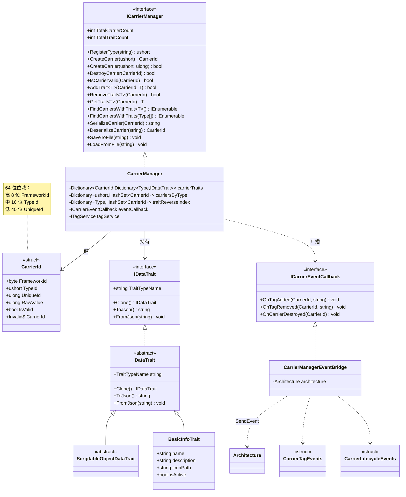

**设计要点**：
- `CarrierManager` **不持有 Tag 状态**。Tag 由独立的 `ITagService` 持有，二者通过 `ICarrierEventCallback` 解耦——`CarrierManager` 销毁载体时锁外广播 `OnCarrierDestroyed`，接收方在**自己的锁内**清理索引，避免锁嵌套（代码注释明确记录了这个死锁面考量）。
- 序列化时 `SerializeCarrier` 从 `tagService` 读取 Tag，且**必须在进入本类锁之前取完**——同样是为了避免与 Tag 服务的锁嵌套。
- `traitReverseIndex` 是 Trait 类型 → 载体的反向索引，用于 `FindCarriersWithTrait` 的 O(1) 查询。

### 2.5 Tag 子系统（双实现）

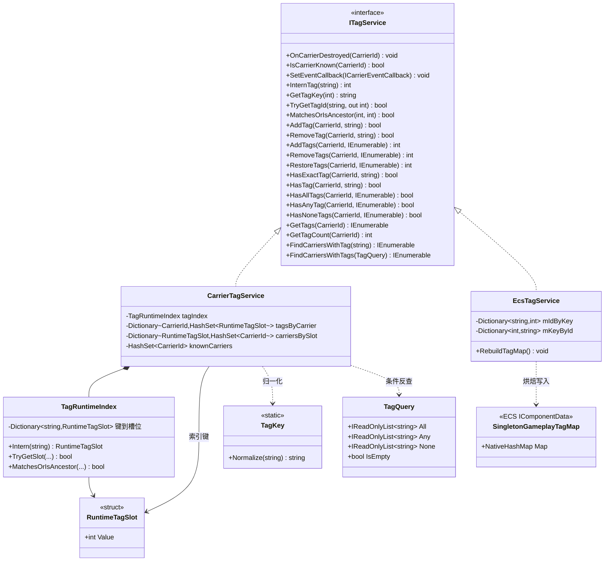

**两套实现的语义差异**：

| 维度 | `CarrierTagService`（框架默认） | `EcsTagService`（GAS 覆盖） |
|---|---|---|
| 槽位来源 | `TagRuntimeIndex` intern，运行时动态分配 | 配置表 `exgas.gameplayTags` 的 Tag ID |
| 状态真相源 | 托管字典 `tagsByCarrier` + `carriersBySlot` | ECS `BFixedTag` / `BTemporaryTag` Buffer |
| 层级推导 | 点分路径运行时推导祖先链 | 启动期烘焙进 `SingletonGameplayTagMap`，Burst 热路径可读 |
| `OnCarrierDestroyed` | 清理正向 + 反向索引残留 | 空实现（无托管账本，ECS 为准） |
| 未配置的 Tag 键 | 自动创建槽位 | `InternTag` 返回 0（键必须已在配置表） |

**`RestoreTags` 的特殊性**：反序列化专用，批量写入但**不触发** `TagAdded` 事件——加载存档不应引发一连串变更广播。两条路径（`CarrierManager.DeserializeCarrier` → `tagService.RestoreTags`）都遵守该约定。

---

## 3. GAS 层类图

### 3.1 GASArchitecture 与服务/模型

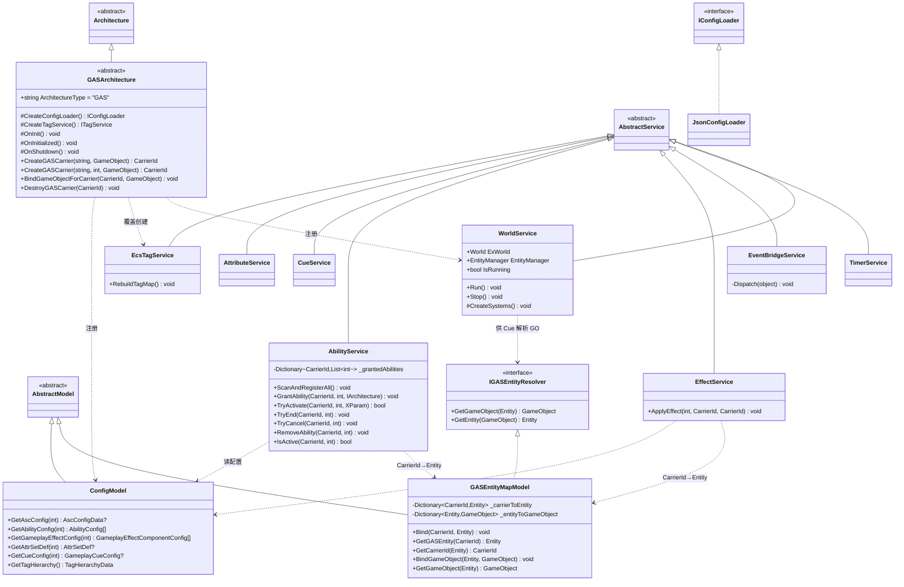

### 3.2 ConfigModel 装载的配置类型

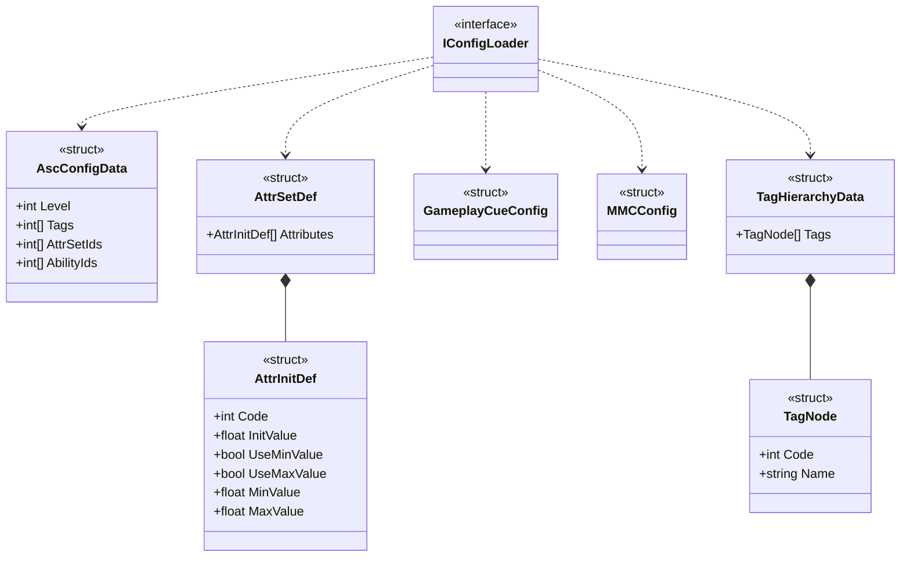

---

## 4. ECS 层模型

### 4.1 组件分类（按生命周期语义）

```mermaid
classDiagram
    direction TB

    class IComponentData { <<interface>> }
    class IBufferElementData { <<interface>> }
    class IEnableableComponent { <<interface>> }

    %% ── ASC 主体 ──
    class CAscBasicData {
        +int Level
    }
    class BFixedTag {
        +int tag
    }
    class BTemporaryTag {
        +int tag
    }
    class BGameplayEffect {
        +Entity Effect
    }
    class BAbility {
        +Entity Ability
    }
    class BEAttrSet {
        +int Code
        +NativeArray~CAttributeData~ Attributes
    }
    class CAttributeData {
        +int Code
        +float BaseValue
        +float CurrentValue
        +float MinValue
        +float MaxValue
        +bool Dirty
    }
    class CAttributeIsDirty
    class CGASRunningTag
    class SingletonGameplayTagMap {
        +NativeHashMap~int,ComGameplayTag~ Map
    }

    %% ── Effect 静态配置（Instantiate 时挂载）──
    class CEffectBasicInfo {
        +int Code
    }
    class CDuration
    class CPeriod
    class CStacking {
        +EffectStackType
        +EffectDurationRefreshPolicy
        +EffectPeriodResetPolicy
        +EffectExpirationPolicy
    }
    class MCModifiers {
        +EffectModifier[] Modifiers
    }
    class MCGrantedAbility {
        +GrantedAbility[] Abilities
    }
    class CEffectGrantedTags
    class CApplicationRequiredTags
    class COngoingRequiredTags
    class CEffectImmunityTags
    class CRemoveEffectWithTags
    class CCueOnAdd
    class CCueOnApply
    class CCueOnActivate
    class CCueOnTick
    class CCueOnDeactivate
    class CCueOnRemove

    %% ── Effect Wip 状态机（操作推进）──
    class WipInstantiateEffect
    class WipCheckApplyEffect
    class WipApplyEffect
    class WipCheckActiveEffect
    class WipActivateEffect
    class WipDeactivateEffect
    class WipRemoveEffect
    class CEffectInUsage {
        +Entity Source
        +Entity Target
    }
    class CEffectInstance {
        +Entity Instigator
    }
    class CEffectApplied
    class CEffectDestroy
    class CCreatedByAbility

    %% ── Ability ──
    class CAbilityBaseInfo {
        +int Code
        +Entity Owner
        +int Level
    }
    class MCAbilityLogic {
        +AbilityLogicBase logic
    }
    class CAbilityActive
    class CAbilityInTryActivate
    class CAbilityInTryEnd
    class CAbilityInTryCancel
    class CAbilityCooldown
    class CAbilityCost
    class CAbilityActivationRequiredTags
    class CAbilityActivationBlockedTags
    class CAbilityActivationOwnedTags
    class CGrantedByEffect
    class MCGrantedAbilityRuntime

    %% ── Cue ──
    class MCCue {
        +CueSetting[] Settings
    }
    class ECCuePlayable
    class ECCuePlaying
    class ECKillCue
    class CPlayRequiredTags
    class CPlayImmunitedTags

    IComponentData <|.. CAscBasicData
    IComponentData <|.. CAttributeData
    IComponentData <|.. CAttributeIsDirty
    IComponentData <|.. CGASRunningTag
    IComponentData <|.. SingletonGameplayTagMap
    IComponentData <|.. CEffectBasicInfo
    IComponentData <|.. CDuration
    IComponentData <|.. CPeriod
    IComponentData <|.. CStacking
    IComponentData <|.. MCModifiers
    IComponentData <|.. MCGrantedAbility
    IComponentData <|.. CEffectGrantedTags
    IComponentData <|.. CApplicationRequiredTags
    IComponentData <|.. COngoingRequiredTags
    IComponentData <|.. CEffectImmunityTags
    IComponentData <|.. CRemoveEffectWithTags
    IComponentData <|.. CCueOnAdd
    IComponentData <|.. CCueOnApply
    IComponentData <|.. CCueOnActivate
    IComponentData <|.. CCueOnTick
    IComponentData <|.. CCueOnDeactivate
    IComponentData <|.. CCueOnRemove
    IComponentData <|.. WipInstantiateEffect
    IComponentData <|.. WipCheckApplyEffect
    IComponentData <|.. WipApplyEffect
    IComponentData <|.. WipCheckActiveEffect
    IComponentData <|.. WipActivateEffect
    IComponentData <|.. WipDeactivateEffect
    IComponentData <|.. WipRemoveEffect
    IComponentData <|.. CEffectInUsage
    IComponentData <|.. CEffectInstance
    IComponentData <|.. CEffectApplied
    IComponentData <|.. CEffectDestroy
    IComponentData <|.. CCreatedByAbility
    IComponentData <|.. CAbilityBaseInfo
    IComponentData <|.. MCAbilityLogic
    IComponentData <|.. CAbilityActive
    IComponentData <|.. CAbilityInTryActivate
    IComponentData <|.. CAbilityInTryEnd
    IComponentData <|.. CAbilityInTryCancel
    IComponentData <|.. CAbilityCooldown
    IComponentData <|.. CAbilityCost
    IComponentData <|.. CAbilityActivationRequiredTags
    IComponentData <|.. CAbilityActivationBlockedTags
    IComponentData <|.. CAbilityActivationOwnedTags
    IComponentData <|.. CGrantedByEffect
    IComponentData <|.. MCCue
    IComponentData <|.. CPlayRequiredTags
    IComponentData <|.. CPlayImmunitedTags
    IEnableableComponent <|.. ECCuePlayable
    IEnableableComponent <|.. ECCuePlaying
    IEnableableComponent <|.. ECKillCue
    IBufferElementData <|.. BFixedTag
    IBufferElementData <|.. BTemporaryTag
    IBufferElementData <|.. BGameplayEffect
    IBufferElementData <|.. BAbility
    IBufferElementData <|.. BEAttrSet
```

### 4.2 Entity 结构

三种 Entity 实体各自携带的组件集合：

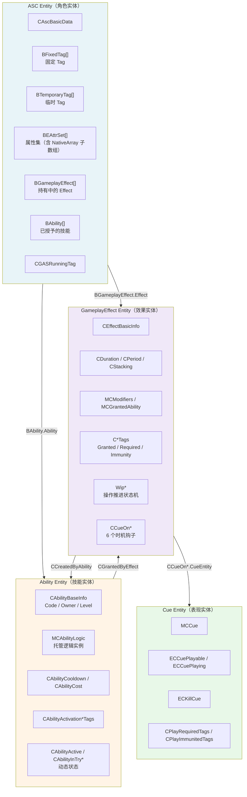

### 4.3 Bridge 与 XParam 多态

```mermaid
classDiagram
    class GASInternalBridge {
        <<static>>
        -List~Action~ _pendingEvents
        +event Action OnBeforeDrain
        +event Action~object~ OnEventEnqueued
        +Enqueue(Action) void
        +Enqueue~T~(T) void
        +Drain() void
        +Clear() void
    }
    note for GASInternalBridge "ECS 系统（Burst/Job）无法直接调托管事件系统，<br/>先入队，由 SEventForwarder 在 Presentation 阶段 Drain"

    class SEventForwarder {
        <<SystemBase>>
    }
    class EventBridgeService {
        -Dispatch(object) void
    }

    class GEAppliedEvent { <<struct>> }
    class GEActivatedEvent { <<struct>> }
    class GERemovedEvent { <<struct>> }
    class AttributeChangedEvent { <<struct>> }
    class AttributeBaseChangedEvent { <<struct>> }
    class AbilityActivatedEvent { <<struct>> }
    class AbilityEndedEvent { <<struct>> }
    class AbilityCancelledEvent { <<struct>> }
    class EffectStackChangedEvent { <<struct>> }

    class XParam {
        <<interface>>
    }
    class XParamNone
    class XParamInt
    class XParamFloat
    class XParamBool
    class XParamString
    class XParamVector2
    class XParamVector3
    class XParamArrayInt
    class XParamArrayFloat
    class XParamAnimator
    class XParamEffectIDs
    class XParamCueIDs
    class XParamApplyEffects
    class XParamALTimelineID
    class XParamCue
    class XParamLogging
    class XParamPlaySound
    class XParamMountPrefab
    class XParamMMCScalable
    class AttributeBasedMmcParam
    class MmcParaFloatScale

    class IDataTrait { <<interface>> }
    class DataTrait { <<abstract>> }
    class GASEntityTrait

    SEventForwarder ..> GASInternalBridge : Drain
    GASInternalBridge ..> EventBridgeService : OnEventEnqueued
    EventBridgeService ..> GEAppliedEvent
    EventBridgeService ..> GEActivatedEvent
    EventBridgeService ..> GERemovedEvent
    EventBridgeService ..> AttributeChangedEvent
    EventBridgeService ..> AttributeBaseChangedEvent
    EventBridgeService ..> AbilityActivatedEvent
    EventBridgeService ..> AbilityEndedEvent
    EventBridgeService ..> AbilityCancelledEvent
    EventBridgeService ..> EffectStackChangedEvent

    XParam <|.. XParamNone
    XParam <|.. XParamInt
    XParam <|.. XParamFloat
    XParam <|.. XParamBool
    XParam <|.. XParamString
    XParam <|.. XParamVector2
    XParam <|.. XParamVector3
    XParam <|.. XParamArrayInt
    XParam <|.. XParamArrayFloat
    XParam <|.. XParamAnimator
    XParam <|.. XParamEffectIDs
    XParam <|.. XParamCueIDs
    XParam <|.. XParamApplyEffects
    XParam <|.. XParamALTimelineID
    XParam <|.. XParamCue
    XParam <|.. XParamLogging
    XParam <|.. XParamPlaySound
    XParam <|.. XParamMountPrefab
    XParam <|.. XParamMMCScalable
    XParam <|.. AttributeBasedMmcParam
    XParam <|.. MmcParaFloatScale

    DataTrait <|-- GASEntityTrait
    IDataTrait <|.. DataTrait
```

**`XParam` 的角色**：配置表的「载荷多态基类」。`AbilityComponentConfig` / `GameplayEffectComponentConfig` / `GameplayCueBase<T>` / `AbilityTaskBase<T>` / `TargetCatcherBase<T>` / `ModMagnitudeCalculationBase<T>` 全部以 `XParam` 为泛型约束——**一类逻辑 + 一个 XParam 子类 = 一个可配置项**。新增逻辑只需新建这一对，`AbilityService.ScanAndRegisterAll()` 会通过反射自动注册。

### 4.4 策略基类家族

```mermaid
classDiagram
    class AbilityLogicBase {
        <<abstract>>
        +Execute(...)
    }
    class AbilityLogicBase~T~ {
        <<abstract>>
        +SetParam(T) void
    }
    class ALApplyEffect
    class ALDebugLog
    class ALTimeline

    class AbilityTaskBase {
        <<abstract>>
    }
    class AbilityTaskBase~T~ {
        <<abstract>>
    }
    class TaskApplyEffects
    class TaskDoCooldown
    class TaskDoCost
    class TaskPlayCue
    class TaskDebug
    class TaskDoNothing

    class TargetCatcherBase {
        <<abstract>>
    }
    class TargetCatcherBase~T~ {
        <<abstract>>
    }
    class CatchSelf
    class CatchTarget
    class CatchAreaBox3D

    class ModMagnitudeCalculationBase {
        <<abstract>>
    }
    class ModMagnitudeCalculationBase~T~ {
        <<abstract>>
    }
    class MMCNone
    class MMCScalableFloat
    class MMCAttributeBased
    class IAttributeValueResolver {
        <<interface>>
    }
    class DefaultAttributeValueResolver

    class GameplayCueBase {
        <<abstract>>
    }
    class GameplayCueBase~T~ {
        <<abstract>>
    }
    class CueLog
    class CueLogging
    class CuePlayAnimator
    class CuePlaySound
    class CueMountPrefab

    AbilityLogicBase <|-- AbilityLogicBase~T~
    AbilityLogicBase~T~ <|-- ALApplyEffect
    AbilityLogicBase~T~ <|-- ALDebugLog
    AbilityLogicBase~T~ <|-- ALTimeline

    AbilityTaskBase <|-- AbilityTaskBase~T~
    AbilityTaskBase~T~ <|-- TaskApplyEffects
    AbilityTaskBase~T~ <|-- TaskDoCooldown
    AbilityTaskBase~T~ <|-- TaskDoCost
    AbilityTaskBase~T~ <|-- TaskPlayCue
    AbilityTaskBase~T~ <|-- TaskDebug
    AbilityTaskBase~T~ <|-- TaskDoNothing

    TargetCatcherBase <|-- TargetCatcherBase~T~
    TargetCatcherBase~T~ <|-- CatchSelf
    TargetCatcherBase~T~ <|-- CatchTarget
    TargetCatcherBase~T~ <|-- CatchAreaBox3D

    ModMagnitudeCalculationBase <|-- ModMagnitudeCalculationBase~T~
    ModMagnitudeCalculationBase~T~ <|-- MMCNone
    ModMagnitudeCalculationBase~T~ <|-- MMCScalableFloat
    ModMagnitudeCalculationBase~T~ <|-- MMCAttributeBased
    MMCAttributeBased ..> IAttributeValueResolver
    IAttributeValueResolver <|.. DefaultAttributeValueResolver

    GameplayCueBase <|-- GameplayCueBase~T~
    GameplayCueBase~T~ <|-- CueLog
    GameplayCueBase~T~ <|-- CueLogging
    GameplayCueBase~T~ <|-- CuePlayAnimator
    GameplayCueBase~T~ <|-- CuePlaySound
    GameplayCueBase~T~ <|-- CueMountPrefab
```

**工厂注册表**：`AbilityLogicFactory`（Logic + Task）、`TargetCatcherHelper`（Catcher）由 `AbilityService.ScanAndRegisterAll()` 在 `OnInit` 时反射填充。扫描范围是 **GAS 程序集 + Architecture 所在程序集**——框架自带逻辑在 GAS 程序集，项目自定义逻辑与 Architecture 同程序集。

---

## 5. 行为模型

### 5.1 Architecture 状态机

```mermaid
stateDiagram-v2
    [*] --> NotInitialized
    NotInitialized --> Initializing : Initialize()
    Initializing --> Initialized : OnInit → InitAll → OnInitialized
    Initialized --> Paused : Pause()
    Paused --> Initialized : Resume()
    Initialized --> Shutting : Shutdown()
    Paused --> Shutting : Shutdown()
    Shutting --> Shutdown : DeInitAll + Clear + Dispose
    Shutdown --> [*]
    NotInitialized --> Shutdown : Dispose()

    note right of Pause
        Pause() 仅当 State == Initialized 时生效
    end note
    note right of Resume
        Resume() 仅当 State == Paused 时生效
    end note
    note right of Initialize
        Initialize() 幂等：mInitialized 为 true 时直接返回
    end note
```

### 5.2 GameplayEffect 生命周期状态机

Effect 通过 **Wip\* 组件**标记「待执行的操作」，各 `SG*` 系统组轮流消费自己负责的 Wip 标记并推进到下一阶段。

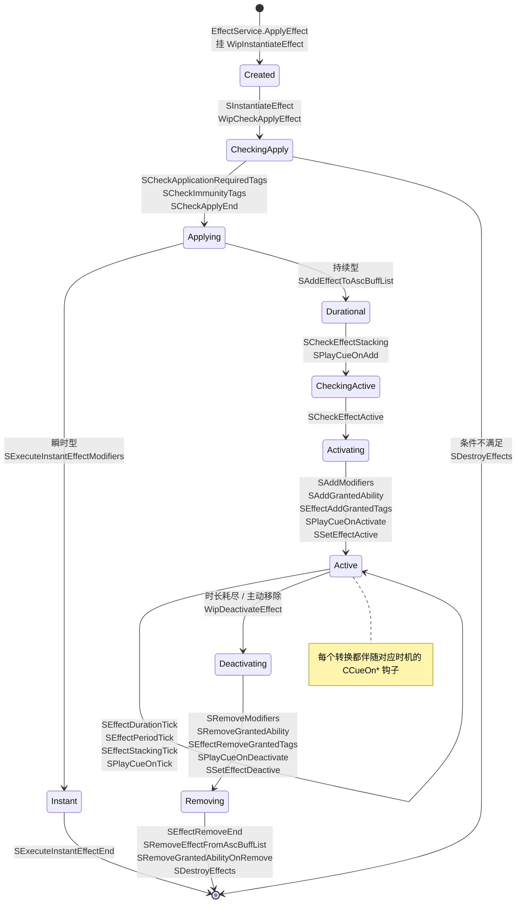

### 5.3 Ability 生命周期状态机

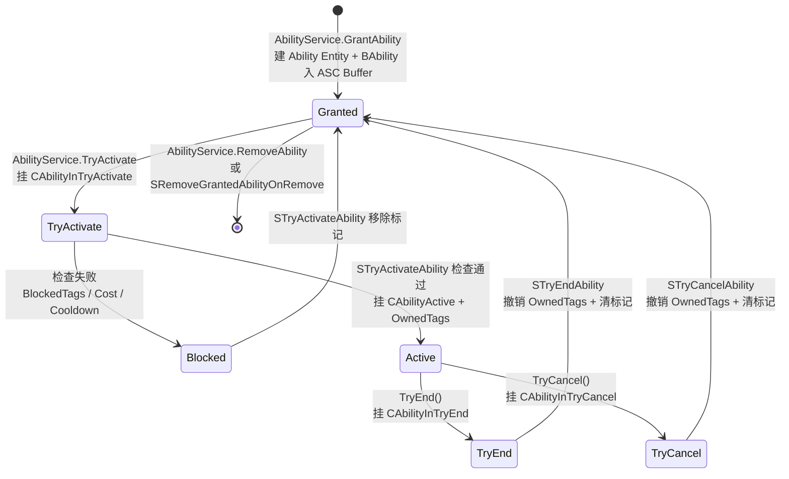

**激活检查项**（`STryActivateAbility`）：`CAbilityActivationRequiredTags`（必须持有）→ `CAbilityActivationBlockedTags`（不得持有）→ `CAbilityCost`（代价支付）→ `CAbilityCooldown`（冷却就绪）→ `CCancelAbilityWithTags`（激活时取消其他技能）。

---

## 6. ECS 系统组树

`WorldService.CreateSystems()` 构建的完整层级：

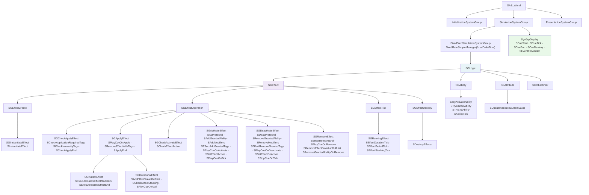

**执行时序**：全部逻辑跑在 `FixedStepSimulationSystemGroup`（固定步长），与 `Time.fixedDeltaTime` 对齐——保证技能/效果的确定性推进。表现类（Cue）跑在 `SimulationSystemGroup` 的 `SysGrpDisplay`。

---

## 7. 关键时序

### 7.1 Carrier 创建全链路（GAS 模式）

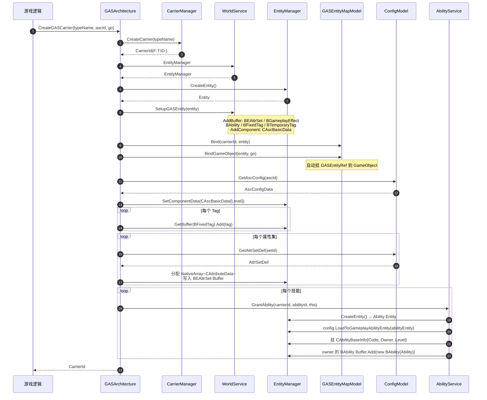

### 7.2 ApplyEffect 跨层链路

展示「托管 API 调用 → ECS Wip 状态机 → 事件回传托管层」的完整闭环。

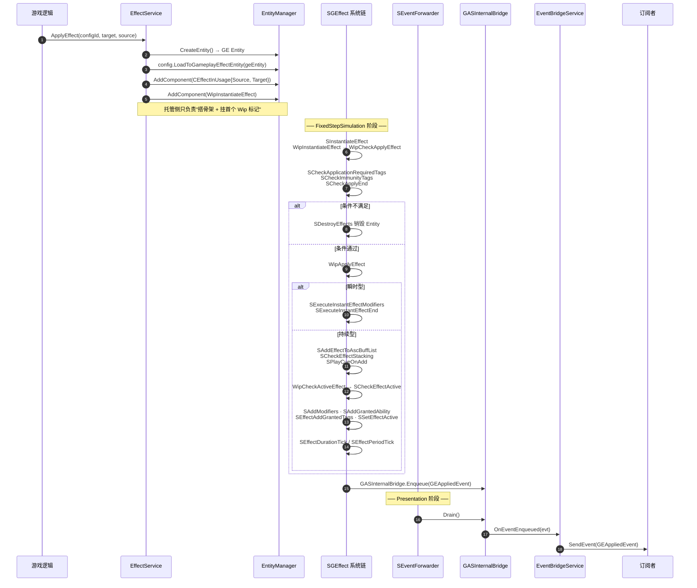

**为什么需要 `GASInternalBridge`**：ECS 系统（可能运行在 Job / Burst 上下文）不能直接调用托管的事件系统。入队 → 在 `SysGrpDisplay` 的 `SEventForwarder` 中统一 `Drain()`，把 ECS 侧事件搬到主线程托管世界。

### 7.3 Tag 查询的层级匹配

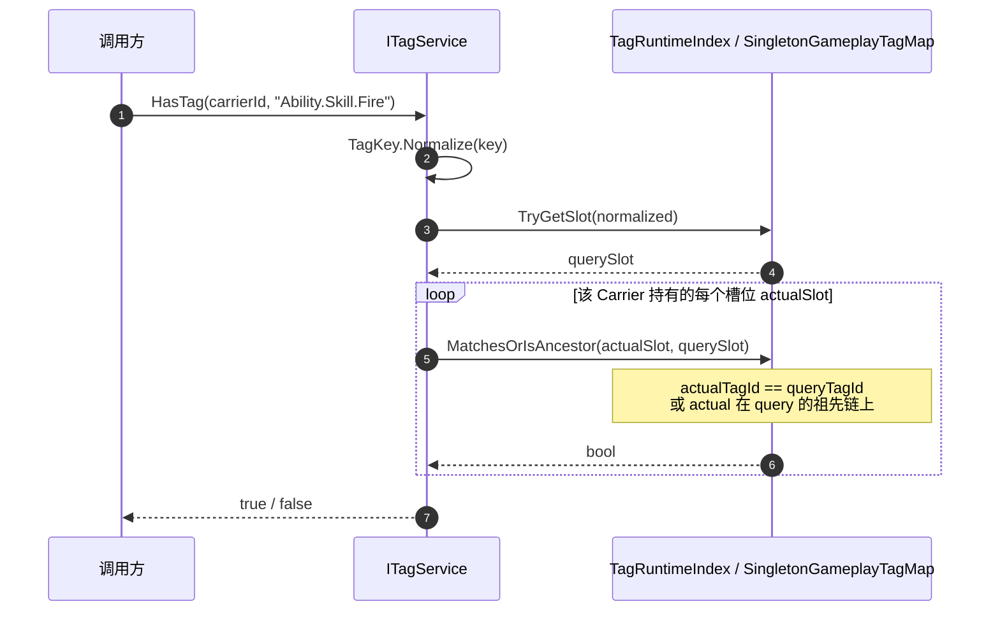

**语义**：`HasTag` 是**父 Tag 命中子 Tag**——Carrier 持有 `Ability.Skill.Fire`，则查询 `Ability.Skill` 返回 `true`。`HasExactTag` 才是精确匹配。`FindCarriersWithTag` 同样遵循层级语义（遍历 `carriersBySlot` 对每个槽位做祖先判定后并集）。

---

## 8. 依赖关系速查

| 依赖方向 | 说明 | 是否允许 |
|---|---|---|
| `NexusFramework.GAS` → `NexusFramework` | GAS 继承 `Architecture` / `AbstractService` / `AbstractModel` | ✅ |
| `NexusFramework` → `NexusFramework.GAS` | 框架层反向依赖 | ❌ 禁止 |
| `NexusFramework` → `Unity.Entities` | 框架层引入 ECS | ❌ 禁止（保持框架层宿主无关） |
| `GASArchitecture` → `EcsTagService` | 通过 `CreateTagService()` 虚方法覆盖 | ✅ |
| `CarrierManager` → `ITagService` | 仅序列化时读写，不持有 Tag 状态 | ✅ |
| `ITagService` → `CarrierManager` | 仅校验载体有效性 + 枚举已知载体 | ✅（双向但职责不重叠） |
| ECS 系统 → 托管事件系统 | 直接调用 | ❌ 必须经 `GASInternalBridge` |
| 托管 Service → ECS | 经 `WorldService.EntityManager` | ✅ |

---

## 9. 扩展点

新增一类玩法逻辑的标准路径：

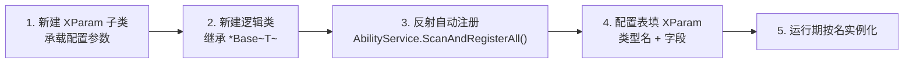

| 扩展目标 | 基类 | 泛型约束 | 注册表 |
|---|---|---|---|
| 技能逻辑 | `AbilityLogicBase<T>` | `XParam` | `AbilityLogicFactory` |
| 技能任务（Timeline 片段） | `AbilityTaskBase<T>` | `XParam` | `AbilityLogicFactory` |
| 目标抓取 | `TargetCatcherBase<T>` | `XParam` | `TargetCatcherHelper` |
| 伤害/数值计算 | `ModMagnitudeCalculationBase<T>` | `XParam` | 由 `MMCConfig` 指定 |
| 表现 | `GameplayCueBase<T>` | `XParam` | `CueHelper` |
| 数据特征 | `DataTrait` | — | 载体 `AddTrait<T>` |

**装配约束**：`XParam` 子类需标 `[BeanField]` / `[BeanPolymorphicField]` 特性，供配置反序列化识别字段。

---

## 附：程序集依赖

```mermaid
graph BT
    NF["NexusFramework.asmdef"]
    GAS["NexusFramework.GAS.asmdef"]
    GASEDITOR["NexusFramework.GAS.Editor.asmdef"]
    TESTS["Tests.asmdef"]
    DEMO["Demo.asmdef"]
    PIPE["Unity.Pipeline.*"]

    GAS --> NF
    TESTS --> NF
    TESTS --> GAS
    DEMO --> NF
    DEMO --> GAS
    GASEDITOR --> GAS
    GASEDITOR --> PIPE

    style NF fill:#e8f4f8
    style GAS fill:#fff4e6
```
